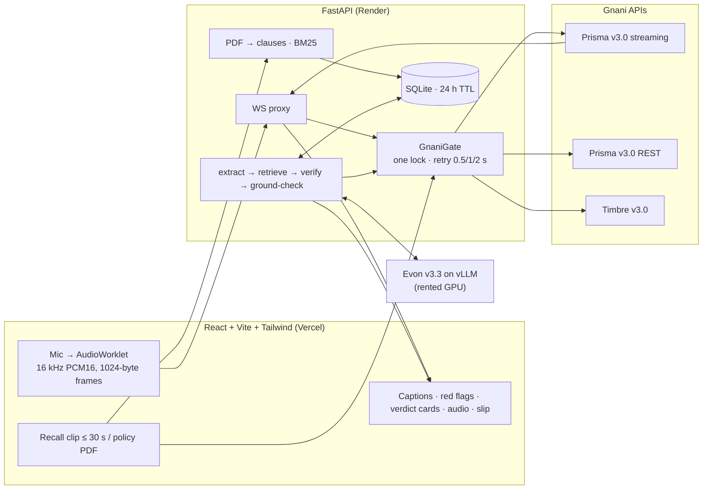

# LikhKeDo — *Jo bola, kya woh likha hai?*

**LikhKeDo ("put it in writing") listens to an insurance or bank sales pitch in Hindi, Hinglish, Tamil, Marathi or English, pulls out every spoken promise, checks each one against the policy's Customer Information Sheet, and tells the buyer — out loud, in their language — which promises are written, which the document contradicts, and which they should ask to get in writing.**

Built for the Gnani AI Great Indian AI Internship Challenge on Gnani's stack: Prisma (speech-to-text), Evon (reasoning, self-hosted) and Timbre (text-to-speech). Demo data is fictional. **Not financial or legal advice.**

## The problem

Mis-selling is the single largest category of life-insurance complaints in India. IRDAI recorded **26,667 "unfair business practice" grievances against life insurers in FY25, up about 14%**, or 22% of all life-insurance complaints ([Outlook Money, reporting the IRDAI annual report](https://www.outlookmoney.com/personal-finance/insurance-claims-mis-selling-account-for-most-insurance-complaints-in-fy25-reveals-irdai-annual-report)). The pattern is familiar: "bilkul FD jaisa", "returns guaranteed", "sirf paanch saal premium". The promise is spoken; the 40-page English document says something else; the buyer, often older, signs anyway.

## How it works (30 seconds)

1. **Hear** — *Listen* mode streams the pitch live (Prisma v3.0 streaming, code-mixed, finance keyterms) and lights up red-flag phrases. *Recall* mode lets the buyer say afterwards what they were told (Prisma v3.0 REST) — no recording of the seller needed.
2. **Read** — the policy PDF becomes numbered clauses with page numbers (pdfplumber + BM25).
3. **Check** — Evon v3.3 extracts each promise with its exact quote, then compares it with the top clauses and the full CIS (reasoning on) and returns WRITTEN / CONTRADICTED / NOT_IN_WRITING with the exact clause quote.
4. **Ground** — code, not the model, has the last word: the promise quote must appear in the transcript, the clause quote must appear in the cited clause, and every number in a WRITTEN verdict must be in that clause. Anything that fails becomes *Not in writing — ask*.
5. **Speak** — Timbre v3.0 (Tarika) reads a slow summary with pauses in the buyer's language. One tap prints a *Likh Ke Do* slip for the seller to sign, and explains the 30-day free look.



## Gnani models and exactly how we use them

| Model | Where | How |
| --- | --- | --- |
| **Prisma v3.0 streaming** | Listen mode | `wss://api.vachana.ai/stt/v3/stream`, `format=codemix`, `language_code="<lang>,en-IN"`, 21 finance keyterms, 1024-byte PCM16 frames every 32 ms, `commit` on stop ([backend/app/stream_proxy.py](backend/app/stream_proxy.py)) |
| **Prisma v3.0 REST** | Recall mode, demo seeding | `POST /stt/v3`, codemix + keyterms + topic; clips over 28 s split on silence with `previous_text` ([backend/app/gnani.py](backend/app/gnani.py)) |
| **Evon v3.3 (30B-A3B)** | Extraction + verification | Self-hosted on vLLM (OpenAI-compatible). Extraction with thinking off (2,048 tokens); verification with thinking on (4,096 tokens); only `message.content` is used; language **and script** named in every prompt; Pydantic validation with one repair retry ([backend/app/evon.py](backend/app/evon.py), [prompts.py](backend/app/prompts.py)) |
| **Timbre v3.0** | Spoken summary, per-promise audio, consent announcement | Voice Tarika with `<slow>` and `<pauses>`; fallback combination on HTTP 400; cached by text hash so each sentence is paid for once |

All Gnani calls pass through one `asyncio.Lock` (the account may allow one active request); 429/500/503/504 retry after 0.5, 1 and 2 s; every call is logged with its request id, status and latency, and the report's **Under the hood** panel shows them. No other LLM is called anywhere.

## Three modes, always labelled

| Mode | What runs | Badge on the report |
|---|---|---|
| **A** | Prisma + Timbre + Evon (BF16 on vLLM, or the community 4-bit GGUF on llama.cpp for ₹0, see [EVON_FREE.md](EVON_FREE.md)) | `Live check · <engine label>` |
| **B** | Prisma + Timbre; promises checked by plain keyword and number rules when Evon is down and the user chooses it | `Rules check — no AI model` |
| **C** | Results saved from a real mode-A run, served when no Evon server is up | `Saved from a live check — <date>` |

No other LLM is ever used in place of Evon.

## Measured API behaviour

Measured on 7 Nov 2026 with `scripts/smoke_timbre.py`, `smoke_prisma.py`, `concurrency_probe.py` and `try_gnani_client.py`, on an 11 s Hindi/Hinglish pitch clip (the clip itself was synthesised with Timbre). Evon numbers come after the GPU is up.

| Item | Result |
| --- | --- |
| Prisma v3.0 REST, 11.0 s clip, `hi-IN,en-IN`, codemix + keyterms | HTTP 200, detected `hi-IN`, processing 0.22–0.25 s, wall 0.7–1.1 s |
| Codemix output | English finance words stay Latin ("FD", "returns guaranteed", "premium"); small numbers come back as words ("बारह percent", "पाँच साल") |
| Prisma v3.0 streaming | `language_code` must be **one** locale (`hi-IN`); `hi-IN,en-IN` returns an error and closes with 1008. Connected 0.4 s, `speech_start` 0.7 s, transcript 0.3 s after `commit` (server latency ~225 ms) |
| Timbre v3.0, Tarika, `hi-IN`, speed 0.9, 24 kHz | HTTP 200 on the first combination; 136 chars → 11.0 s audio in 2.8 s. WAV header sizes are `0xFFFFFFFF` (streaming style); we patch them |
| Timbre v3.0, Tarika, Hindi / Tamil / Marathi pitches (~900 chars each, 2 chunks) | All HTTP 200 on the first combination: 57.0 s / 51.3 s / 54.5 s of audio in 9.1 / 9.5 / 8.7 s (`scripts/make_pitch_audio.py`) |
| Round trip: Timbre pitch audio → Prisma REST (3 chunks ≤ 30 s each) | Detected `hi-IN` / `ta-IN` / `mr-IN`; transcript vs. source text similarity 93 / 92 / 95 % (rapidfuzz ratio). So Tarika is intelligible in Tamil and Marathi |
| Browser stream through our proxy (11 s clip) | 1024-byte frames paced at 32 ms, 0 Prisma errors; the saved debug WAV transcribed over REST matches the live caption word for word |
| Does an open stream block Timbre? | **No**: Timbre returned 200 in 0.94 s while a stream was open, so streams don't hold GnaniGate (`STREAM_HOLDS_LOCK=false`) |
| Request ids | Gnani echoes our `X-API-Request-ID` as `request_id`, so the ids in **Under the hood** match Gnani's logs |
| Credits per Prisma call / per Timbre call | _check the balance on app.gnani.ai before and after a call_ |
| Evon latency: extraction / one verification | _pending (GPU)_ |

## Accuracy

`scripts/eval_answer_key.py` runs the pipeline on three fictional pitches (Hindi/Hinglish, Tamil+English, Marathi; 6 promises each: 2 written, 2 contradicted, 2 not in writing) against the fictional CIS and writes [demo/eval_results.md](demo/eval_results.md). _Not run yet against the live Evon; numbers will be reported as they come out._

The answer key now has **30 labelled promises** in 5 pitches. Two of them (`hi_hinglish_2`, `en_english`: 12 promises on lock-in, bonus, charges, premium amount, surrender, claims) were written *after* the rules check, with their expected verdicts fixed before any run, so they are a held-out test.

| Mode B (rules, no AI model) | Original 3 pitches (rules written with them in view) | Held-out 2 pitches |
| --- | --- | --- |
| On the pitch text | 18/18 | **2/12**; one wrong *Written* ("returns fixed at 8 percent" matched the illustrated 8%) |
| After one post-hoc safety fix (an illustrated rate is never *Written*) | 18/18 | 2/12, no wrong *Written* or *Different on paper* |
| On Prisma v3.0 transcripts of the Timbre audio | 15/18 | 1/12 (English numbers come back as words) |

So keyword rules don't generalise: they are a labelled fallback that errs towards "ask for it in writing", not a substitute for Evon. Files: [demo/eval_rules.md](demo/eval_rules.md), [demo/eval_rules_stt.md](demo/eval_rules_stt.md), [demo/eval_rules_heldout_before_fix.md](demo/eval_rules_heldout_before_fix.md). Mode A (Evon) numbers: not run yet (no Evon access).

## Noise robustness

`scripts/noise_test.py` mixes background noise at 20, 10 and 5 dB SNR plus an 8 kHz telephone band, and compares Prisma v2.5 (verbatim) with v3.0 (codemix + keyterms). Run on 7 Nov 2026 on the Hindi pitch (Timbre audio) with synthetic noise from `scripts/make_noise.py` (two other pitches talking over each other, and pink noise), scored with the rules check because Evon was not up ([demo/noise_results.md](demo/noise_results.md)):

| Prisma | clean | 20 dB | 10 dB | 5 dB | telephone 8 kHz |
| --- | --- | --- | --- | --- | --- |
| v3.0 codemix + keyterms: similarity to script / correct verdicts (of 6) | 94% · 4 | 95% · 5 | 94% · 4 | 93% · 5 | 93% · 4 |
| v2.5 verbatim | 72% · 0 | 72% · 0 | 72% · 0 | 72% · 0 | 72% · 0 |

v3.0 holds steady from clean audio down to 5 dB babble and telephone-band audio. v2.5 writes everything in Devanagari ("भरोसा लाइफ", "एफ डी"), so it scores lower by construction against a mixed-script script and our keyword rules; that row shows why we use codemix, not that v2.5 hears worse. Caveats: a clean synthetic voice is easier than a real one, and the noise is synthetic. Real-room recordings are still to do.

Live captions, end to end: `scripts/stream_pitch_test.py` streams each pitch through our WebSocket proxy to Prisma at real time, exactly like the browser. Caption similarity to the script: Hindi 96%, Tamil 92%, Marathi 94%, with the red flags firing. One Tamil run was closed by Prisma with code 1012 (service restart); the proxy now reconnects transparently on 1006/1011/1012/1013.

## Honest limitations

- The demo policy, insurer ("Bharosa Life Insurance Ltd (FICTIONAL)") and recordings are synthetic. Real CIS documents vary; scanned PDFs are rejected (no OCR).
- Evon runs only while a GPU session is up (free: the community 4-bit GGUF on Kaggle T4s, quality loss unmeasured; paid: BF16 on vLLM). The rest of the time the public site serves cases saved from a live run and says so (`DEMO_ONLY=true`).
- Code-mixed speech recognition can mishear numbers ("baarah" vs "barah"); the grounding check prefers *Not in writing — ask* over a wrong red card, so errors fall on the cautious side.
- The answer key is small (18 promises); it shows the pipeline works, not production accuracy.
- Hindi, Marathi and Tamil UI strings were drafted by us and need native review.
- The demo CIS is in English, so the *document* quote on each card stays in English even in a Hindi, Marathi or Tamil report (it must be the exact words of the document). Everything else on the card is in the buyer's language; the model's English paraphrase sits behind a "Show English" toggle.
- Live Listen mode records nothing to disk, but everyone present should still know the conversation is being noted.

## Recording the demo

Full recording, posting and submission plan: [LAUNCH.md](LAUNCH.md).

1. Backend with `DEBUG_SAVE_AUDIO=true` (dev only), frontend `npm run dev`, Evon up (`/api/health` shows `"evon":"ok"`).
2. Open `http://localhost:5173/?record=1`: a phone-width column with larger type, and cards that highlight as they appear.
3. Live pitch: a second person reads `demo/pitches/hi_hinglish.txt` into the mic. Or, on `/dev/listen`, use **Start + play pitch audio**, which plays the Timbre pitch from the speakers with echo cancellation off (otherwise the browser cancels the very audio it is meant to capture).
4. Record mic audio, not system audio. `?record=0` turns recording mode off.

## Prior art and how we differ

- **Saakshi** ([lablab.ai hackathon, Sep 2026](https://lablab.ai/submissions/yq8ij2120upfm8wq4mztpj2x)) — seller-side consent proof for advisors' disclosures, on a non-Gnani stack. Same insight (the mis-sale is in the sentence); LikhKeDo serves the *buyer*, in Indic voice, on Gnani.
- **Insurer-side call-vs-document checks** (e.g. the [NuSummit case study](https://www.nusummit.com/?p=53048)) and pre-issuance verification calls compare agent conversations with policy terms inside one insurer. LikhKeDo does the same check for the person being sold to, before they sign.

## Privacy and synthetic data

No accounts, no names, phone numbers, account numbers, Aadhaar or PAN are requested. Raw audio is never written to disk (streamed and discarded; recall clips are processed in memory). Case data is deleted after 24 hours or on *Delete my data*, and so are cached transcripts and synthesized audio. Logs hold request ids, status and latency — never transcript text. Every person, insurer and policy in the demo is fictional; the demo pitch audio is synthesized with Timbre and the test noise is generated, so no real person's voice is used.

## Run locally

```bash
python -m venv backend/.venv
backend/.venv/Scripts/pip install -r backend/requirements.txt      # macOS/Linux: backend/.venv/bin/pip
cd frontend && npm install && cd ..
cp .env.example .env                                               # add GNANI_API_KEY etc.
```

| Task | With make | Without make (Windows PowerShell) |
| --- | --- | --- |
| Backend dev server | `make dev-backend` | `cd backend; .venv\Scripts\python -m uvicorn app.main:app --reload --port 8000` |
| Frontend dev server | `make dev-frontend` | `cd frontend; npm run dev` |
| Backend tests | `make test` | `cd backend; .venv\Scripts\python -m pytest -q` |
| Demo cases (live run only; needs Evon) | | `backend\.venv\Scripts\python scripts\seed_demo.py` |

Uploads go as raw request bodies (`audio/wav`, `application/pdf`) rather than multipart, so the backend needs no extra form-parsing dependency. Deployment: see [DEPLOY.md](DEPLOY.md).

## Team

_Placeholder: names and contributions._
